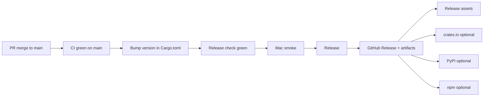

# Release workflow

Ontographia ships **Rust crates + CLI**, a **Python wheel** (PyPI), **Go bindings** (cgo + FFI), and **TypeScript bindings** (npm, with a prebuilt `libontographia_ffi`). Releases are cut from `main` only.

**Changelog:** [GitHub Releases](https://github.com/edgesentry/ontographia/releases) are the source of truth. The Release workflow creates each release with `gh release create … --generate-notes`.

**Trigger policy:** [Release check](https://github.com/edgesentry/ontographia/actions/workflows/release-check.yml) and [Release](https://github.com/edgesentry/ontographia/actions/workflows/release.yml) run **only** via **Run workflow** (`workflow_dispatch`). They **never** start on push to `main`, tag push, or GitHub Release publish events.

## Flow



1. Merge feature work to `main` and confirm [CI](https://github.com/edgesentry/ontographia/actions/workflows/ci.yml) passes.
2. Bump the workspace version on `main` (see [Version bumps](#version-bumps)) — **no local git tag**.
3. Run **[Release check](https://github.com/edgesentry/ontographia/actions/workflows/release-check.yml)** on `main` and wait until it is green. Detail: [GitHub Actions (Release check)](#github-actions-release-check).
4. Run the [Mac workstation](#mac-workstation) smoke (Cursor Agent CLI, checkout under `~/agent-work`).
5. Run **[Release](https://github.com/edgesentry/ontographia/actions/workflows/release.yml)** — reads `Cargo.toml`, creates `vX.Y.Z`, uploads artifacts.

Steps 3 and 4 are the [pre-release checks](#pre-release-checks). Release waits until both are done.

Both workflows share the same internal validation (`scripts/preflight-release.sh`). **No version input** — bump `Cargo.toml` on `main` first.

**Immutable tags:** preflight fails if `vX.Y.Z`, `release-processed/vX.Y.Z`, or `bindings/go/vX.Y.Z` already exists on the remote. After a successful Release start, `release-processed/vX.Y.Z` is claimed; the same version cannot be re-released — bump the version in `Cargo.toml`.

## Pre-release checks

Run these before **Run workflow** on Release. Order:

1. [Release check](https://github.com/edgesentry/ontographia/actions/workflows/release-check.yml) green on `main`.
2. Mac workstation smoke below.
3. Then Release.

Release check validates the commit on `main` (the version in `Cargo.toml`, free tags, pack metadata, tests, wheels). The Mac smoke installs the channels a person on Apple Silicon uses. `brew upgrade` and `npm install` exercise the **already published** artifacts (v0.1.8 today). They do not compile the unreleased commit. The release workflow does not edit the Homebrew tap. After the GitHub Release exists, a follow-up pull request on [`edgesentry/homebrew-tap`](https://github.com/edgesentry/homebrew-tap) points `Formula/ontographia.rb` at the new archive.

The Mac smoke runs under the **Cursor Agent CLI**, from a checkout under `~/agent-work`. agy stays on docs and decks.

### GitHub Actions (Release check)

```bash
gh workflow run "Release check" --ref main
gh run watch --workflow "Release check"
```

The job is `scripts/preflight-release.sh`. It does not create a tag, a GitHub Release, or a registry publish. A green run prints the lines under [Release check (dry-run)](#release-check-dry-run), in that order, and ends with `preflight ok for vX.Y.Z`.

| Check | Green means |
|-------|-------------|
| Version | `Cargo.toml` `[workspace.package] version` and `bindings/typescript/package.json` `version` are the same `X.Y.Z` (`scripts/verify-release-version.sh`) |
| Workflow file | `.github/workflows/release.yml` is named **Release**, the publish job id is `publish-npm`, and `upload-assets` checks out the repo and sets `GH_REPO` |
| Registries | Read-only ping of npm, crates.io, and PyPI (`scripts/check-registry-reachability.sh`) |
| npm packages | `@edgesentry/ontographia` and the four platform packages are on the public registry. The job reads that public document. It does not call `GET /-/package/{package}/trust` |
| npm pack | `scripts/package-npm-dry-run.mjs` packs stub FFI archives. The main tarball lists four `optionalDependencies`. Nothing is uploaded |
| Tags | `vX.Y.Z`, `release-processed/vX.Y.Z`, and `bindings/go/vX.Y.Z` are absent on the remote |
| Build | `scripts/release-check.sh`: `cargo test --workspace`, CLI smoke, `cargo publish --dry-run` for `ontographia-core` only, a release build of the CLI, and maturin wheels for Python 3.11, 3.12, and 3.13 |

Release check does not read `NPM_TRUST_TOKEN`. Do not add `NPM_TRUST_TOKEN`, a Bypass-2fa token, or `NPM_TOKEN` to GitHub Actions. `publish-npm` stays on Trusted Publishing (OIDC). Confirm the five publishers on a maintainer machine with `npm trust list` (commands in [Release check (dry-run)](#release-check-dry-run)). A missing trust token does not fail this job.

A local `bash scripts/preflight-release.sh` runs the same script. The required signal is the Release check workflow on `main`.

### Mac workstation

Apple Silicon. Cursor Agent CLI. Checkout under `~/agent-work`. Record each item. A missing Neo4j server is a skip. The other items are required before Release.

**Homebrew → `otg`.** [`Formula/ontographia.rb`](https://github.com/edgesentry/homebrew-tap/blob/main/Formula/ontographia.rb) installs the Rust binary from the v0.1.8 archives. The command is `otg`.

```bash
brew tap edgesentry/tap
brew upgrade ontographia || brew install ontographia
otg --version
otg build --help
otg schema --help
```

`otg --version` prints `otg` and the formula version. This binary has `build` and `schema`. Read-only `execute` is still the Python entry point ([#121](https://github.com/edgesentry/ontographia/issues/121)).

**npm, darwin-arm64 optional dependency.** Release check packs stub libraries on Linux. It does not load `libontographia_ffi.dylib`. On the Mac, install the published package in a clean directory. npm selects `@edgesentry/ontographia-darwin-arm64` and the dylib sits at the package root (`main` is `./libontographia_ffi.dylib`).

```bash
REPO="${HOME}/agent-work/ontographia"   # this checkout
SMOKE="${HOME}/agent-work/ontographia-npm-smoke"
rm -rf "$SMOKE" && mkdir -p "$SMOKE" && cd "$SMOKE"
npm install @edgesentry/ontographia
test -f node_modules/@edgesentry/ontographia-darwin-arm64/libontographia_ffi.dylib
node --input-type=module -e '
import { readFileSync } from "node:fs";
import { buildCypherFromFiles } from "@edgesentry/ontographia";
const intent = JSON.parse(readFileSync(process.argv[2], "utf8"));
const r = buildCypherFromFiles(process.argv[1], intent);
if (!r.query) process.exit(1);
console.log(r.query.split("\n")[0]);
' "$REPO/examples/manufacturing.native.yaml" "$REPO/examples/sample_intent.json"
```

Node.js 22+. Intel macOS, musl/Alpine, and Windows arm64 have no prebuilt library.

**Python (`uvx` / `pip`).** Library install, separate from Homebrew. On Apple Silicon this wheel is the macOS arm64 build. `build` loads the extension:

```bash
REPO="${HOME}/agent-work/ontographia"   # this checkout
uvx --from "ontographia[cli]" otg build \
  --ontology "$REPO/examples/manufacturing.native.yaml" \
  --intent "$REPO/examples/sample_intent.json"
```

**Neo4j execute, when a server is reachable.** Homebrew `otg` has no `execute` subcommand. Use the Python entry point. The movies demo needs no local database (login published by Neo4j; see [otg CLI](otg.md)):

```bash
REPO="${HOME}/agent-work/ontographia"   # this checkout
uvx --from "ontographia[cli]" otg execute \
  --ontology "$REPO/examples/movies.native.yaml" \
  --intent "$REPO/examples/movies_matrix.json" \
  --neo4j-uri neo4j+s://demo.neo4jlabs.com \
  --neo4j-user movies \
  --neo4j-password movies \
  --neo4j-database movies
```

A local Neo4j (`./scripts/start_neo4j.sh --seed`, then the manufacturing intent in [End-to-end Neo4j](end-to-end-neo4j.md)) is the same check. If neither server answers, record "Neo4j execute skipped" and continue.

**Go, against the Release dylib.** `go get` does not ship `libontographia_ffi`. Download `libontographia_ffi-<version>-macos-arm64.tar.gz` from the latest [GitHub Release](https://github.com/edgesentry/ontographia/releases).

On `main`, `#cgo LDFLAGS` in `bindings/go/ontographia/ontographia.go` is still:

```text
-L${SRCDIR}/../../../target/release -lontographia_ffi -Wl,-rpath,${SRCDIR}/../../../target/release
```

`${SRCDIR}` is `bindings/go/ontographia`, so the linker looks for `<repo>/target/release/libontographia_ffi.dylib`. `DYLD_LIBRARY_PATH` is the runtime search path ([Go](go.md)). The linker does not read it. That checkout-relative `-L` is the open Go link UX: a Release dylib is not discovered on its own. Place the published library on that path, then test. The file must be the Release archive, not a library you just built with `cargo build`.

```bash
# from the repository root, under ~/agent-work
VER=0.1.8   # version already on GitHub Releases
gh release download "v${VER}" --repo edgesentry/ontographia \
  --pattern "libontographia_ffi-${VER}-macos-arm64.tar.gz" --dir /tmp/otg-ffi --clobber
mkdir -p target/release /tmp/otg-ffi
tar -xzf "/tmp/otg-ffi/libontographia_ffi-${VER}-macos-arm64.tar.gz" -C /tmp/otg-ffi
cp "/tmp/otg-ffi/libontographia_ffi-${VER}-macos-arm64/libontographia_ffi.dylib" target/release/
export DYLD_LIBRARY_PATH="$(pwd)/target/release${DYLD_LIBRARY_PATH:+:$DYLD_LIBRARY_PATH}"
cd bindings/go
CGO_ENABLED=1 go test ./...
```

**Apple Silicon.** The Homebrew macOS arm64 archive, `@edgesentry/ontographia-darwin-arm64`, and `libontographia_ffi-*-macos-arm64` are the platform checks Linux Release check cannot run.

## Option A — GitHub Actions

### Release check (dry-run)

1. Open **Actions → Release check**.
2. Click **Run workflow** (branch `main`).
3. Confirm the run passes. Preflight prints these lines, in order:

   - `release version ok`
   - `release workflow ok: .github/workflows/release.yml name=Release job=publish-npm`
   - `registry reachability ok` (read-only npm, crates.io, and PyPI)
   - each of `@edgesentry/ontographia` and the four platform packages `is on the registry`, then `npm packages on registry; trusted publisher settings were not read`
   - `npm pack dry-run ok` (stub FFI archives; four platform `optionalDependencies`; no publish)
   - `tag vX.Y.Z is available`
   - `release check ok` (tests, `cargo publish --dry-run` for `ontographia-core`, wheels)
   - `preflight ok for vX.Y.Z`

No tag or GitHub Release is created. Nothing is published.

The npm package check runs **before** the immutable-tag check. A version whose tag already exists still confirms the five packages are on the registry and packs the npm tarballs, then stops with `tag already exists` and does not build wheels. A green run waits until `Cargo.toml` is a version whose tag is free.

Release check confirms those five packages from the **public** registry document. It does not call `GET /-/package/{package}/trust` and it does not read `NPM_TRUST_TOKEN`. That GET needs a granular token with write access and, when the account has 2FA, an `npm-otp` header. npm warns against Bypass-2fa and publish-and-stage tokens and prefers Trusted Publishing. Do not add `NPM_TRUST_TOKEN`, a Bypass-2fa token, or `NPM_TOKEN` to GitHub Actions. `publish-npm` stays on Trusted Publishing (OIDC) only.

Confirm the publishers yourself after `npm login`:

```bash
npm trust list @edgesentry/ontographia --json
npm trust list @edgesentry/ontographia-linux-x64 --json
npm trust list @edgesentry/ontographia-linux-arm64 --json
npm trust list @edgesentry/ontographia-darwin-arm64 --json
npm trust list @edgesentry/ontographia-win32-x64 --json
```

Each record should be GitHub Actions on `edgesentry/ontographia`, workflow filename `release.yml`, an empty environment, and `createPackage` (**Allow npm publish** on). Do this before the next Release if win32 or the main package might still be missing that publisher. Release check prints the same commands as a warning. A missing trust token does not fail the job.

An optional local read of the same API, outside Actions, is `NPM_TRUST_TOKEN=... node scripts/check-npm-trusted-publishers.mjs`. If npm asks for a one-time code, use `npm trust list`, or set `NPM_TRUST_OTP` for that local process only. GitHub Actions ignores `NPM_TRUST_TOKEN`.

### Release (publish)

1. Bump `[workspace.package] version` in `Cargo.toml` on `main` (see [Version bumps](#version-bumps)).
2. Finish [pre-release checks](#pre-release-checks): Release check green on `main`, then the Mac smoke.
3. Open **Actions → Release**.
4. Click **Run workflow** (branch `main`) — no version field; the workflow reads `Cargo.toml`.

Preflight runs internally, then the workflow creates `vX.Y.Z`, the GitHub Release, and uploads assets.

## Option B — CLI

Requires [GitHub CLI](https://cli.github.com/) (`gh`) authenticated with `repo` scope.

### Release check only

The required run is the workflow on `main`. `scripts/preflight-release.sh` is the same script, for a laptop; it does not replace that run.

```bash
gh workflow run "Release check" --ref main
# same checks locally:
bash scripts/preflight-release.sh
```

### Full release

```bash
# 1. Bump version on main (via PR or locally)
scripts/bump-version.sh 0.1.9 --commit
git push origin main

# 2. Required: Release check workflow on main (see Pre-release checks)
gh workflow run "Release check" --ref main
gh run watch --workflow "Release check"

# 3. Required: Mac workstation smoke (docs/release.md#mac-workstation)
#    Cursor Agent CLI, checkout under ~/agent-work

# 4. Trigger Release (the workflow runs preflight again on the runner)
gh workflow run Release --ref main

# 5. Watch the run
gh run watch --workflow Release
```

`scripts/trigger-release.sh` reads `Cargo.toml`, runs `preflight-release.sh` locally, then `gh workflow run Release`. Use it only after Release check is green on `main` and the Mac smoke is done. The Release workflow still runs preflight on the runner. A local preflight does not replace that workflow run.

### Preflight steps (shared by Release check and Release)

```bash
VERSION="$(bash scripts/workspace-version.sh)"
bash scripts/verify-release-version.sh "v${VERSION}"
node scripts/check-release-workflow.mjs
bash scripts/check-registry-reachability.sh
node scripts/check-npm-trusted-publishers.mjs
node scripts/package-npm-dry-run.mjs
bash scripts/verify-tag-not-exists.sh "v${VERSION}"
bash scripts/release-check.sh
```

(`preflight-release.sh` runs these using the workspace version. In GitHub Actions, `check-npm-trusted-publishers.mjs` only checks that the five packages exist. It reads publisher settings only when `NPM_TRUST_TOKEN` is set outside Actions.)

### Trigger Release only (skip local preflight)

```bash
gh workflow run Release --ref main
```

## Version bumps

**Single source of truth:** root `Cargo.toml` → `[workspace.package] version`.

| Component | Where version lives |
|-----------|---------------------|
| Rust (all crates) | `version.workspace = true` → workspace version |
| Python wheel | `pyproject.toml` `dynamic = ["version"]` → `bindings/python/Cargo.toml` via maturin |
| Go | No file; `bindings/go/vX.Y.Z` tag created by the release workflow |
| TypeScript / npm | `bindings/typescript/package.json` `version`, kept equal to the workspace version by `scripts/bump-version.sh`. Preflight fails if they differ. Platform-package versions are not stored in git; `scripts/package-npm.mjs` stamps the workspace version when it packs them |

```bash
scripts/bump-version.sh 0.1.8 --commit
```

The release workflow rejects versions that do not match `Cargo.toml` (`scripts/verify-release-version.sh`).

## GitHub secrets (optional registry publish)

| Secret | Purpose |
|--------|---------|
| `CARGO_REGISTRY_TOKEN` | `cargo publish` for `ontographia-core`, `-adapters`, `-schema`, `-cli` |
| `PYPI_API_TOKEN` | `maturin upload` to PyPI |

| Variable | Purpose |
|----------|---------|
| `PUBLISH_TO_REGISTRIES` | Set to `true` to enable crates.io / PyPI / npm publish jobs |

npm does not use an Actions secret. Job `publish-npm` authenticates with [npm Trusted Publishing](https://docs.npmjs.com/trusted-publishers/) (GitHub Actions OIDC). The Release workflow grants `id-token: write`, and the job sets that permission again because a job `permissions` block replaces workflow inheritance. `actions/setup-node` is configured with `registry-url: https://registry.npmjs.org`. The job runs `npm publish` (npm CLI **11.5.1+**). Provenance is attached automatically for this public repository; the command does not pass `--provenance`.

Delete the Actions secret `NPM_TOKEN` if it was added. `scripts/publish-npm.sh` exits when `NPM_TOKEN` or a real `NODE_AUTH_TOKEN` is present, so a granular access token (including one that bypasses MFA) cannot publish.

Without registry settings, the workflow still uploads **GitHub Release assets**, including the npm tarballs.

### npm Trusted Publishing (maintainer, once per package)

The scope `@edgesentry` is an npm organization. Creating the GitHub org does not create it. Package names are immutable after the first publish. Do this on npmjs.com as an owner of that org. Laptops and agents do not upload the Release tarballs.

1. Create the npm organization **`edgesentry`** at [npmjs.com/org/create](https://www.npmjs.com/org/create).
2. Create these five package names under that org. The Trusted Publisher form is on a package that already exists ([`npm trust` requires the package on the registry](https://docs.npmjs.com/cli/v11/commands/npm-trust/)). A placeholder version such as `0.0.0`, published by you with an interactive login, is enough for the settings page. Use a version other than the workspace version in `Cargo.toml`, so the Release job still publishes the real tarball. Do not upload the Release `.tgz` files and do not run `scripts/publish-npm.sh`.
   - `@edgesentry/ontographia`
   - `@edgesentry/ontographia-linux-x64`
   - `@edgesentry/ontographia-linux-arm64`
   - `@edgesentry/ontographia-darwin-arm64`
   - `@edgesentry/ontographia-win32-x64`
3. On each package, open **Packages → the package → Settings → Trusted publishing** ([docs](https://docs.npmjs.com/trusted-publishers/)). Choose **GitHub Actions** and save one connection with the fields below. The same screen is `https://www.npmjs.com/package/<name>/access`.
4. On each package, open **Settings → Publishing access**, choose **Require two-factor authentication and disallow tokens**, and save. Trusted Publishing still publishes. An npm token does not.
5. Set the repository variable `PUBLISH_TO_REGISTRIES` to `true`.

Trusted Publisher fields, same on all five packages:

| Field | Value |
|-------|--------|
| Organization or user | `edgesentry` |
| Repository | `ontographia` |
| Workflow filename | `release.yml` |
| Environment name | empty |
| Allow `npm publish` | on |

The file is `.github/workflows/release.yml`. Its workflow `name:` is **Release**. npm matches the filename `release.yml`, including `.yml`. **Run workflow** starts that file directly, so the filename is `release.yml` and the environment stays empty (the job does not set a GitHub environment).

A trusted publisher created after 2026-09-03 allows `npm stage publish` until you also allow direct `npm publish`. The Release job runs `npm publish`. Turn **Allow npm publish** on.

`os` and `cpu` on a platform `package.json` (`scripts/package-npm.mjs`) choose which optional dependency npm installs. They do not decide whether `npm publish` is allowed. The v0.1.7 Release runner was Linux and still published `@edgesentry/ontographia-darwin-arm64@0.1.7` (`"os": ["darwin"]`) with provenance. Leave those fields in place, including on `@edgesentry/ontographia-win32-x64` (`"os": ["win32"]`, `"cpu": ["x64"]`, no `libc`).

**Win32 uses the same Trusted Publisher as the other four packages.** Release run [41265294898](https://github.com/edgesentry/ontographia/actions/runs/41265294898) published `@edgesentry/ontographia-darwin-arm64`, `@edgesentry/ontographia-linux-arm64`, and `@edgesentry/ontographia-linux-x64` at `0.1.7` via OIDC. `@edgesentry/ontographia-win32-x64@0.1.7` then returned `ENEEDAUTH` (`need auth`). The package already exists (`0.0.0` and `0.0.0-stage`); `0.1.7` was not published, and neither was `@edgesentry/ontographia@0.1.7`, because the script stopped at the first failure. That is a missing, expired, or publish-disallowed Trusted Publisher on the win32 package alone. Re-check [its access page](https://www.npmjs.com/package/@edgesentry/ontographia-win32-x64/access) against the table above before re-running Release. Do the same for [`@edgesentry/ontographia`](https://www.npmjs.com/package/@edgesentry/ontographia/access) if the main package has not been published at this version yet.

A new connection must complete its first successful publish within **2 days** or it expires. Save it when you are about to run Release, and run Release inside that window. An expired connection is deleted and created again; it cannot be edited.

**npm publish is allowed only in the Release job `publish-npm`.** `scripts/publish-npm.sh` exits before it talks to the registry unless `GITHUB_ACTIONS=true`, `GITHUB_WORKFLOW=Release`, and `GITHUB_JOB=publish-npm`, and unless the OIDC request variables from `id-token: write` are present. `bindings/typescript` sets `prepublishOnly` so `npm publish` in that directory fails. Packing (`scripts/package-npm.mjs` / `npm pack`, including `scripts/package-npm-dry-run.mjs` in preflight) does not upload. Preflight also refuses a `release.yml` whose name is not **Release**, whose publish job id is not `publish-npm`, or whose `upload-assets` job has no checkout and no `GH_REPO`. Those are the OIDC and `gh release upload` invariants. `scripts/check-npm-trusted-publishers.mjs` confirms the five packages exist before any publish job. In GitHub Actions it does not call the authenticated trust API and it does not publish. Confirm publishers locally with `npm trust list`.

### Re-running a failed Release

If a Release run fails partway through (for example after `ontographia-core` was already published, or after the Go module tag was pushed), fix the workflow or bump the version as needed, then **Run workflow** again on the same `Cargo.toml` version:

- **crates.io:** publish jobs skip crates that already exist at the workspace version.
- **Go:** the workflow fails fast if `bindings/go/vX.Y.Z` already exists — do not delete that tag; bump the version instead.
- **npm:** platform tarballs publish first (lexical filename order: `darwin-arm64`, `linux-arm64`, `linux-x64`, `win32-x64`), then `@edgesentry/ontographia`. Versions already on npm are skipped, so a re-run is safe when some packages are already at this version (for `0.1.7`, the three platform packages above). A missing trusted publisher, a workflow filename other than `release.yml`, or a publisher that does not allow `npm publish` makes that one package return `ENEEDAUTH`. The script still attempts the remaining tarballs, then exits non-zero and lists the names that are not on the registry. npm versions are immutable; replace a bad native by bumping `Cargo.toml` (and the TypeScript `package.json` via `scripts/bump-version.sh`). Do not delete tag `v0.1.7` to retry this publish.
- **GitHub Release assets:** `upload-assets` checks out the release tag and sets `GH_REPO`. `gh release upload` needs a git checkout or `GH_REPO`; without either it exits `fatal: not a git repository`. The upload overwrites files of the same name (`--clobber`).

**Re-run uses the workflow file from that run's commit**, not a later commit on `main`. For [run 41265294898](https://github.com/edgesentry/ontographia/actions/runs/41265294898) (`c6ca92a`, tag `v0.1.7`):

1. On npm, open [@edgesentry/ontographia-win32-x64 access](https://www.npmjs.com/package/@edgesentry/ontographia-win32-x64/access) and save the same Trusted Publisher as the other four packages (table above, **Allow npm publish** on). Also confirm [@edgesentry/ontographia access](https://www.npmjs.com/package/@edgesentry/ontographia/access) before the main package is published.
2. **Re-run failed jobs** on that run. `publish-npm` checks out tag `v0.1.7`. The script on that tag already skips `@edgesentry/ontographia-darwin-arm64@0.1.7`, `@edgesentry/ontographia-linux-arm64@0.1.7`, and `@edgesentry/ontographia-linux-x64@0.1.7`, then publishes win32 and `@edgesentry/ontographia`. Do this only after step 1. The continue-on-failure behavior in this document is on `main` after the fix is merged; the tag does not move.
3. Do not expect that same re-run to fix `upload-assets`. It still executes the workflow from `c6ca92a`, which does not check out the repo. Do not start a new Release for `0.1.7`: preflight refuses because `v0.1.7` and `release-processed/v0.1.7` already exist. Do not delete those tags. Attach the assets from the run with `gh release upload v0.1.7 <files> --clobber` (the run's artifacts are the CLI, FFI, wheel, and npm tarballs). The checkout fix applies to the next Release, which is a new `Cargo.toml` version.

## Install after release

| Channel | Role |
|---------|------|
| Homebrew `brew install ontographia` | Primary CLI. Rust binary. The published formula installs the command **`otg`** ([`Formula/ontographia.rb`](https://github.com/edgesentry/homebrew-tap/blob/main/Formula/ontographia.rb), v0.1.8 archives). `build` and `schema` are in this binary. Read-only `execute` is still the Python entry point ([#121](https://github.com/edgesentry/ontographia/issues/121)) |
| `pip` / `uvx` extras (`ontographia[cli]`, `[llm]`, `[mcp]`) | Python library and the Python `otg` entry point |
| crates.io | Rust libraries and `cargo install ontographia-cli` |
| Go module + `libontographia_ffi-*` on the GitHub Release | cgo bindings |
| npm `@edgesentry/ontographia` | TypeScript / JavaScript. Prebuilt `libontographia_ffi` for Linux x64, Linux arm64, macOS arm64, and Windows x64 |
| `ontographia[mcp]` via `uvx` or pip | MCP server |

Guide: [otg CLI](otg.md). Decision: [#121](https://github.com/edgesentry/ontographia/issues/121).

### CLI (GitHub Release, Homebrew, or crates.io)

The published tap installs `otg` from the **v0.1.8** archives (macOS arm64, Linux x86_64):

```bash
brew tap edgesentry/tap
brew install ontographia
otg build --ontology manufacturing.native.yaml --intent intent.json --json
otg schema manufacturing.native.yaml --out constraints.cypher --json-out schema.json
```

crates.io `ontographia-cli` 0.1.8 installs the same binary name:

```bash
cargo install ontographia-cli
otg --version
```

Cargo builds `otg`. `ontographia-{version}-{target}.tar.gz` also contains a copy of that file named `ontographia`. `--version` prints `otg` for both files. The formula prefers `otg` and, for an older archive that only has `ontographia`, installs that file as `otg`. The release workflow does not edit the tap. After the next GitHub Release, a follow-up pull request on `edgesentry/homebrew-tap` points `Formula/ontographia.rb` at the new archive.

A checkout:

```bash
cargo install --path crates/ontographia-cli
otg build --help
```

Rust `otg` has `build` and `schema`. Read-only `execute` in that binary is [#121](https://github.com/edgesentry/ontographia/issues/121). Until it ships, shell execute is the Python entry point below.

### Rust libraries

```toml
ontographia-core = "0.1"
ontographia-adapters = "0.1"
ontographia-schema = "0.1"
```

### Python

Supported: **3.11, 3.12, 3.13** (`requires-python = ">=3.11"`). CI runs Python smoke and Neo4j integration on all three; releases ship wheels for **Linux x86_64**, **Linux arm64**, **macOS arm64**, and **Windows x86_64** (12 wheels per version).

```bash
pip install ontographia
pip install "ontographia[llm]"   # optional Intent layer
pip install "ontographia[mcp]"   # optional MCP server (ontographia-mcp)
pip install "ontographia[cli]"   # Python otg entry point (read-only execute)
uvx --from "ontographia[cli]" otg --help
```

### Go

```bash
go get github.com/edgesentry/ontographia/bindings/go@v0.1.8
```

Download the matching `libontographia_ffi-*` archive from GitHub Releases for cgo linking (`linux-x86_64`, `linux-arm64`, `macos-arm64`, `windows-x86_64`). On `main`, `#cgo LDFLAGS` still passes `-L${SRCDIR}/../../../target/release` (`bindings/go/ontographia/ontographia.go`). `DYLD_LIBRARY_PATH` / `LD_LIBRARY_PATH` cover runtime. The linker looks in that checkout `target/release` directory. Copy the Release library there before `go test`. That path is the open Go link UX. The Mac steps are in [Mac workstation](#mac-workstation).

The release workflow creates `bindings/go/vX.Y.Z` on the same commit as `vX.Y.Z` (the `main` checkout that created the GitHub Release). The `release-processed/vX.Y.Z` claim uses that same checkout. Neither tag uses the commit that merely started the manual workflow, which can differ when `main` has moved or the run was dispatched from another ref.

### TypeScript / JavaScript

Node.js **22+**.

```bash
npm install @edgesentry/ontographia
```

That install also selects one platform package (`os` / `cpu` / `libc`) and downloads a single prebuilt library:

| Package | Host |
|---------|------|
| `@edgesentry/ontographia-linux-x64` | Linux x64, glibc |
| `@edgesentry/ontographia-linux-arm64` | Linux arm64, glibc |
| `@edgesentry/ontographia-darwin-arm64` | macOS Apple Silicon |
| `@edgesentry/ontographia-win32-x64` | Windows x64 |

musl/Alpine, macOS x64, and Windows arm64 are not built. Set `ONTOGRAPHIA_FFI_LIB` (or `ONTOGRAPHIA_FFI_DIR`) to load a custom shared library; those variables override the prebuild. A git checkout still uses `target/release` when no prebuild is installed (`cargo build --release -p ontographia-ffi`).

The same tarballs are attached to the GitHub Release (`edgesentry-ontographia-*.tgz`) for a registry-less install. Uploading them to npm happens only in the Release workflow when `PUBLISH_TO_REGISTRIES` is `true`. Local `npm publish` is forbidden; see [GitHub secrets](#github-secrets-optional-registry-publish).

User guide (`docs/typescript.md`) is still deferred. Package notes: [bindings/typescript](https://github.com/edgesentry/ontographia/tree/main/bindings/typescript).

## Artifacts

| Artifact | Contents |
|----------|----------|
| `ontographia-{version}-{target}.tar.gz` | CLI binary `otg`, plus a copy named `ontographia` so an older formula that looks up that filename still installs. The v0.1.8 formula prefers `otg`. `--version` prints `otg` |
| `libontographia_ffi-{version}-{target}.tar.gz` | Shared library for Go/cgo (`linux-x86_64`, `linux-arm64`, `macos-arm64`, `windows-x86_64`). The npm job consumes these same archives |
| `ontographia-{version}-*.whl` | Python package (Linux x86_64/arm64, macOS arm64, Windows x86_64 × Python 3.11–3.13) |
| `edgesentry-ontographia-{version}.tgz` | npm package `@edgesentry/ontographia` (loader + `optionalDependencies` on the platform packages) |
| `edgesentry-ontographia-<platform>-{version}.tgz` | Prebuilt `libontographia_ffi` for `linux-x64`, `linux-arm64`, `darwin-arm64`, `win32-x64` |

## Related

- [architecture.md](architecture.md)
- [AGENTS.md](https://github.com/edgesentry/ontographia/blob/main/AGENTS.md)
