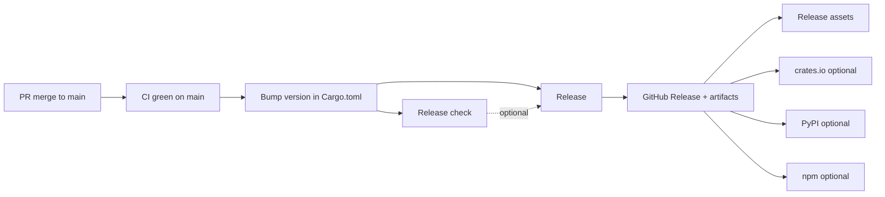

# Release workflow

Ontographia ships **Rust crates + CLI**, a **Python wheel** (PyPI), **Go bindings** (cgo + FFI), and **TypeScript bindings** (npm, with a prebuilt `libontographia_ffi`). Releases are cut from `main` only.

**Changelog:** [GitHub Releases](https://github.com/edgesentry/ontographia/releases) are the source of truth. The Release workflow creates each release with `gh release create … --generate-notes`.

**Trigger policy:** [Release check](https://github.com/edgesentry/ontographia/actions/workflows/release-check.yml) and [Release](https://github.com/edgesentry/ontographia/actions/workflows/release.yml) run **only** via **Run workflow** (`workflow_dispatch`). They **never** start on push to `main`, tag push, or GitHub Release publish events.

## Flow



1. Merge feature work to `main` and confirm [CI](https://github.com/edgesentry/ontographia/actions/workflows/ci.yml) passes.
2. Bump the workspace version on `main` (see [Version bumps](#version-bumps)) — **no local git tag**.
3. **(Recommended)** Run **[Release check](https://github.com/edgesentry/ontographia/actions/workflows/release-check.yml)** — dry-run only; no tag or release is created.
4. Run **[Release](https://github.com/edgesentry/ontographia/actions/workflows/release.yml)** — reads `Cargo.toml`, creates `vX.Y.Z`, uploads artifacts.

Both workflows share the same internal validation (`scripts/preflight-release.sh`). **No version input** — bump `Cargo.toml` on `main` first.

**Immutable tags:** preflight fails if `vX.Y.Z`, `release-processed/vX.Y.Z`, or `bindings/go/vX.Y.Z` already exists on the remote. After a successful Release start, `release-processed/vX.Y.Z` is claimed; the same version cannot be re-released — bump the version in `Cargo.toml`.

## Option A — GitHub Actions

### Release check (dry-run)

1. Open **Actions → Release check**.
2. Click **Run workflow** (branch `main`).
3. Confirm the run passes (version from `Cargo.toml`, tests, `cargo publish --dry-run` for `ontographia-core`, wheel build).

No tag or GitHub Release is created.

### Release (publish)

1. Bump `[workspace.package] version` in `Cargo.toml` on `main` (see [Version bumps](#version-bumps)).
2. Open **Actions → Release**.
3. Click **Run workflow** (branch `main`) — no version field; the workflow reads `Cargo.toml`.

Preflight runs internally, then the workflow creates `vX.Y.Z`, the GitHub Release, and uploads assets.

## Option B — CLI

Requires [GitHub CLI](https://cli.github.com/) (`gh`) authenticated with `repo` scope.

### Release check only

```bash
bash scripts/preflight-release.sh
# or trigger the Release check workflow:
gh workflow run "Release check" --ref main
```

### Full release

```bash
# 1. Bump version on main (via PR or locally)
scripts/bump-version.sh 0.1.6 --commit
git push origin main

# 2. (Recommended) dry-run
bash scripts/preflight-release.sh
# or: gh workflow run "Release check" --ref main

# 3. Preflight locally + trigger Release workflow
scripts/trigger-release.sh

# 4. Watch the run
gh run watch --workflow Release
```

`trigger-release.sh` reads `Cargo.toml`, runs `preflight-release.sh`, then `gh workflow run Release`. The Release workflow still runs preflight on the runner.

### Preflight steps (shared by Release check and Release)

```bash
VERSION="$(bash scripts/workspace-version.sh)"
bash scripts/verify-release-version.sh "v${VERSION}"
bash scripts/verify-tag-not-exists.sh "v${VERSION}"
bash scripts/release-check.sh
```

(`preflight-release.sh` runs all three using the workspace version.)

### Trigger Release only (skip local preflight)

```bash
gh workflow run Release --ref main
```

## Version bumps

**Single source of truth:** root `Cargo.toml` → `[workspace.package] version`.

| Component | Where version lives |
|-----------|---------------------|
| Rust (all crates) | `version.workspace = true` → workspace version |
| Python wheel | `pyproject.toml` `dynamic = ["version"]` → `bindings/python/Cargo.toml` via maturin |
| Go | No file; `bindings/go/vX.Y.Z` tag created by the release workflow |
| TypeScript / npm | `bindings/typescript/package.json` `version`, kept equal to the workspace version by `scripts/bump-version.sh`. Preflight fails if they differ. Platform-package versions are not stored in git; `scripts/package-npm.mjs` stamps the workspace version when it packs them |

```bash
scripts/bump-version.sh 0.1.6 --commit
```

The release workflow rejects versions that do not match `Cargo.toml` (`scripts/verify-release-version.sh`).

## GitHub secrets (optional registry publish)

| Secret | Purpose |
|--------|---------|
| `CARGO_REGISTRY_TOKEN` | `cargo publish` for `ontographia-core`, `-adapters`, `-schema`, `-cli` |
| `PYPI_API_TOKEN` | `maturin upload` to PyPI |
| `NPM_TOKEN` | `npm publish` for `@edgesentry/ontographia` and the four platform packages. The workflow maps this secret to `NODE_AUTH_TOKEN`. Use a granular access token that can publish `@edgesentry/*`, with 2FA bypass for CI, or a classic automation token. A token that still prompts for OTP will fail the job |

| Variable | Purpose |
|----------|---------|
| `PUBLISH_TO_REGISTRIES` | Set to `true` to enable crates.io / PyPI / npm publish jobs |

Without registry settings, the workflow still uploads **GitHub Release assets**, including the npm tarballs.

**npm org.** The scope `@edgesentry` is an npm org, not something GitHub creates. It has to exist on [npmjs.com](https://www.npmjs.com/org/create) before the first publish (`edgesentry`). If the org is missing, the Release job's `npm publish` fails with a scope error. Package names are immutable after the first successful publish, so confirm the scope before running Release with the registry flag on.

**Do not publish npm from a laptop or an agent.** `npm publish` is forbidden outside the GitHub Actions workflow named **Release**, job id `publish-npm`. `scripts/publish-npm.sh` exits before it talks to the registry unless `GITHUB_ACTIONS=true`, `GITHUB_WORKFLOW=Release`, and `GITHUB_JOB=publish-npm`. That job still runs only when `PUBLISH_TO_REGISTRIES` is `true`, and it reads secret `NPM_TOKEN`. `bindings/typescript` sets `prepublishOnly` so `npm publish` in that directory fails even if someone points npm at a token. Packing (`scripts/package-npm.mjs` / `npm pack`) does not upload and is the local check.

### Re-running a failed Release

If a Release run fails partway through (for example after `ontographia-core` was already published, or after the Go module tag was pushed), fix the workflow or bump the version as needed, then **Run workflow** again on the same `Cargo.toml` version:

- **crates.io:** publish jobs skip crates that already exist at the workspace version.
- **Go:** the workflow fails fast if `bindings/go/vX.Y.Z` already exists — do not delete that tag; bump the version instead.
- **npm:** platform packages publish first, then `@edgesentry/ontographia`. Versions already on npm are skipped. npm versions are immutable; replace a bad native by bumping `Cargo.toml` (and the TypeScript `package.json` via `scripts/bump-version.sh`). If `PUBLISH_TO_REGISTRIES` is `true` and `NPM_TOKEN` is missing, the npm job fails the same way a missing `PYPI_API_TOKEN` fails PyPI.
- **GitHub Release assets:** the upload step overwrites release files when re-run succeeds.

## Install after release

| Channel | Role |
|---------|------|
| Homebrew `brew install ontographia` | Primary CLI. Rust binary. The command is **`otg`** once [`Formula/ontographia.rb`](https://github.com/edgesentry/homebrew-tap/blob/main/Formula/ontographia.rb) is pointed at that filename. Read-only Neo4j execute belongs in this binary |
| `pip` / `uvx` extras (`ontographia[cli]`, `[llm]`, `[mcp]`) | Python library and the Python `otg` entry point |
| crates.io | Rust libraries and `cargo install ontographia-cli` |
| Go module + `libontographia_ffi-*` on the GitHub Release | cgo bindings |
| npm `@edgesentry/ontographia` | TypeScript / JavaScript. Prebuilt `libontographia_ffi` for Linux x64, Linux arm64, macOS arm64, and Windows x64 |
| `ontographia[mcp]` via `uvx` or pip | MCP server |

Guide: [otg CLI](otg.md). Decision: [#121](https://github.com/edgesentry/ontographia/issues/121).

### CLI (GitHub Release, Homebrew, or crates.io)

The published tap (assets from **v0.1.3**) installs a binary named `ontographia`:

```bash
brew tap edgesentry/tap
brew install ontographia
```

```bash
ontographia build --ontology manufacturing.native.yaml --intent intent.json --json
ontographia schema manufacturing.native.yaml --out constraints.cypher --json-out schema.json
```

crates.io matches the last published crate:

```bash
cargo install ontographia-cli
```

**Next CLI release.** Cargo builds `otg`. `ontographia-{version}-{target}.tar.gz` contains that binary and a copy named `ontographia`, so the current formula keeps installing. `--version` prints `otg` for both files. After that release is published, a follow-up pull request on `edgesentry/homebrew-tap` changes `Formula/ontographia.rb` to install `otg` and can drop the extra filename from the archive. The release workflow does not edit the tap. Open the tap pull request only after the `otg` binary is in the GitHub Release.

A checkout that already builds both filenames:

```bash
cargo install --path crates/ontographia-cli
otg build --help
```

Rust `otg` here has `build` and `schema`. Read-only `execute` in that binary is [#121](https://github.com/edgesentry/ontographia/issues/121). Until it ships, shell execute is the Python entry point below.

### Rust libraries

```toml
ontographia-core = "0.1"
ontographia-adapters = "0.1"
ontographia-schema = "0.1"
```

### Python

Supported: **3.11, 3.12, 3.13** (`requires-python = ">=3.11"`). CI runs Python smoke and Neo4j integration on all three; releases ship wheels for **Linux x86_64**, **Linux arm64**, **macOS arm64**, and **Windows x86_64** (12 wheels per version).

```bash
pip install ontographia
pip install "ontographia[llm]"   # optional Intent layer
pip install "ontographia[mcp]"   # optional MCP server (ontographia-mcp)
pip install "ontographia[cli]"   # Python otg entry point (read-only execute)
uvx --from "ontographia[cli]" otg --help
```

### Go

```bash
go get github.com/edgesentry/ontographia/bindings/go@v0.1.6
```

Download the matching `libontographia_ffi-*` archive from GitHub Releases for cgo linking (`linux-x86_64`, `linux-arm64`, `macos-arm64`, `windows-x86_64`).

The release workflow creates `bindings/go/vX.Y.Z` automatically.

### TypeScript / JavaScript

Node.js **22+**.

```bash
npm install @edgesentry/ontographia
```

That install also selects one platform package (`os` / `cpu` / `libc`) and downloads a single prebuilt library:

| Package | Host |
|---------|------|
| `@edgesentry/ontographia-linux-x64` | Linux x64, glibc |
| `@edgesentry/ontographia-linux-arm64` | Linux arm64, glibc |
| `@edgesentry/ontographia-darwin-arm64` | macOS Apple Silicon |
| `@edgesentry/ontographia-win32-x64` | Windows x64 |

musl/Alpine, macOS x64, and Windows arm64 are not built. Set `ONTOGRAPHIA_FFI_LIB` (or `ONTOGRAPHIA_FFI_DIR`) to load a custom shared library; those variables override the prebuild. A git checkout still uses `target/release` when no prebuild is installed (`cargo build --release -p ontographia-ffi`).

The same tarballs are attached to the GitHub Release (`edgesentry-ontographia-*.tgz`) for a registry-less install. Uploading them to npm happens only in the Release workflow when `PUBLISH_TO_REGISTRIES` is `true`. Local `npm publish` is forbidden; see [GitHub secrets](#github-secrets-optional-registry-publish).

User guide (`docs/typescript.md`) is still deferred. Package notes: [bindings/typescript](https://github.com/edgesentry/ontographia/tree/main/bindings/typescript).

## Artifacts

| Artifact | Contents |
|----------|----------|
| `ontographia-{version}-{target}.tar.gz` | CLI binary `otg`, plus a copy named `ontographia` so the current tap formula keeps installing. `--version` prints `otg`. Drop the copy after the tap installs `otg` |
| `libontographia_ffi-{version}-{target}.tar.gz` | Shared library for Go/cgo (`linux-x86_64`, `linux-arm64`, `macos-arm64`, `windows-x86_64`). The npm job consumes these same archives |
| `ontographia-{version}-*.whl` | Python package (Linux x86_64/arm64, macOS arm64, Windows x86_64 × Python 3.11–3.13) |
| `edgesentry-ontographia-{version}.tgz` | npm package `@edgesentry/ontographia` (loader + `optionalDependencies` on the platform packages) |
| `edgesentry-ontographia-<platform>-{version}.tgz` | Prebuilt `libontographia_ffi` for `linux-x64`, `linux-arm64`, `darwin-arm64`, `win32-x64` |

## Related

- [architecture.md](architecture.md)
- [AGENTS.md](https://github.com/edgesentry/ontographia/blob/main/AGENTS.md)
