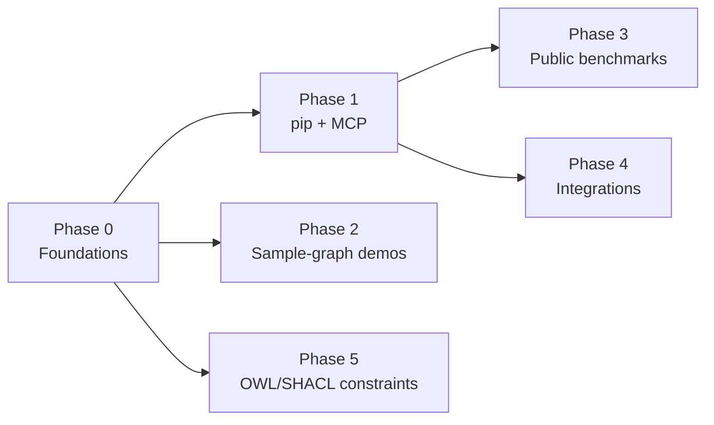

# Roadmap

This roadmap describes where Ontographia is heading. It is organized into phases with rough dependencies, not dates. Each workstream is tracked as an **epic** issue (label [`epic`](https://github.com/edgesentry/ontographia/labels/epic)); concrete work lives in its sub-issues.

Ontographia's core principle stays fixed throughout: the LLM produces only **Intent JSON**; a deterministic, ontology-constrained pipeline in the Rust core validates it and emits **parameter-bound Cypher**. The LLM never writes Cypher.

> Evaluation results referenced by this roadmap are published in [evaluation.md](evaluation.md). The roadmap itself makes no performance claims.

## Overview

| Phase | Theme | Epics | Depends on |
|-------|-------|-------|------------|
| 0 | Foundations | [#82](https://github.com/edgesentry/ontographia/issues/82), [#83](https://github.com/edgesentry/ontographia/issues/83) | — |
| 1 | pip-installable and agent-ready | [#84](https://github.com/edgesentry/ontographia/issues/84), [#85](https://github.com/edgesentry/ontographia/issues/85) | Phase 0 |
| 2 | Familiar demos | [#86](https://github.com/edgesentry/ontographia/issues/86) | Phase 0 (can run in parallel with Phase 1) |
| 3 | Reproducible public benchmarks | [#87](https://github.com/edgesentry/ontographia/issues/87) | Phase 1 (Intent layer packaging) |
| 4 | Ecosystem integrations | [#88](https://github.com/edgesentry/ontographia/issues/88) | Phase 1 |
| 5 | Constraints from existing ontologies | [#89](https://github.com/edgesentry/ontographia/issues/89) | Phase 0 (any time after) |

## Phase 0 — Foundations

### Repo hygiene & public roadmap — [#82](https://github.com/edgesentry/ontographia/issues/82)
- Close evaluation issues that are already complete
- Publish this roadmap
- Use milestones and epics; attach existing issues as sub-issues
- Keep dependency updates moving; start a `CHANGELOG.md`

### Getting started quality — [#83](https://github.com/edgesentry/ontographia/issues/83)
- 5-minute quickstart: `pip install ontographia` → query the Movies graph
- One-page explainer: why the LLM never writes Cypher
- Troubleshooting page and auto-generated API reference
- Fix outdated content in docs and README (Intent field names, sample outputs)

## Phase 1 — pip-installable and agent-ready

### Intent layer packaging (`ontographia[llm]`) — [#84](https://github.com/edgesentry/ontographia/issues/84)
- Promote the Intent layer from `examples/llm/` (ontology subset prompts with full-schema fallback, execution-feedback refinement, difficulty-adaptive spend) into an optional extra, e.g. `pip install "ontographia[llm]"`
- Pluggable LLM backend (LiteLLM or any OpenAI-compatible endpoint)
- Move the related tests into the main test suite

### MCP server — [#85](https://github.com/edgesentry/ontographia/issues/85)
- Candidate tools: `intent_schema`, `build_cypher`, `execute` (read-only), `list_ontology`
- Neo4j connection settings; launch via `uvx`; configuration examples for Claude Desktop and Cursor
- Policy that rejects write queries; consistent with the existing [Agent Skill](https://github.com/edgesentry/ontographia/blob/main/skills/ontographia-cypher-builder/SKILL.md)

## Phase 2 — Familiar demos

### Neo4j sample-graph quickstarts — [#86](https://github.com/edgesentry/ontographia/issues/86)
- Ontologies and gold questions for Movies, Northwind, and Recommendations (reusing the Track B schema→COM converter)
- Notebooks that connect directly to `demo.neo4jlabs.com`, plus Colab versions
- Sub-issues: [#57](https://github.com/edgesentry/ontographia/issues/57) (public domain graph), [#48](https://github.com/edgesentry/ontographia/issues/48) (generalize Intent repair beyond manufacturing heuristics)

## Phase 3 — Reproducible public benchmarks

### Reproducible public benchmark suite — [#87](https://github.com/edgesentry/ontographia/issues/87)
- Pin target databases and split of [`neo4j/text2cypher-2025v1`](https://huggingface.co/datasets/neo4j/text2cypher-2025v1); one command to reproduce
- Direct LLM→Cypher baseline under identical model settings ([#56](https://github.com/edgesentry/ontographia/issues/56))
- Semantic-equivalence / soft execution matching for Cypher paraphrases ([#73](https://github.com/edgesentry/ontographia/issues/73))
- Safety metrics first: invented vocabulary, unbound literals, write-query leakage
- Results page and regression checks in CI

## Phase 4 — Ecosystem integrations

### Framework integrations (LangChain / LlamaIndex / neo4j-graphrag) — [#88](https://github.com/edgesentry/ontographia/issues/88)
- LangChain Tool / Retriever
- LlamaIndex PropertyGraph retriever
- neo4j-graphrag retriever adapter
- An example and docs page for each; upstream docs listings where possible

## Phase 5 — Constraints from existing ontologies

### OWL/SHACL constraint enforcement — [#89](https://github.com/edgesentry/ontographia/issues/89)
- Enforce SHACL constraints (`minCount`, `maxCount`, `pattern`, `in`) during Intent validation
- Stricter OWL domain/range handling
- Generate Neo4j constraints from the ontology
- Import sample from a public ontology (e.g. a schema.org subset)
- Related: [#48](https://github.com/edgesentry/ontographia/issues/48) (mapping-driven repair / semantic validation)

## Contributing

Pick an open sub-issue under any epic, or open a new issue and reference the relevant epic. See [AGENTS.md](https://github.com/edgesentry/ontographia/blob/main/AGENTS.md) and the [docs](index.md) for repository conventions.
